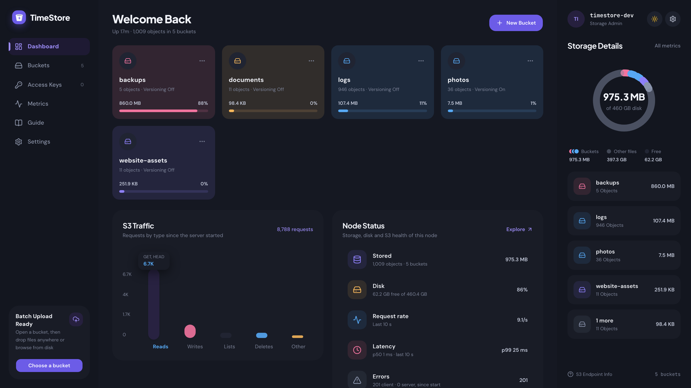
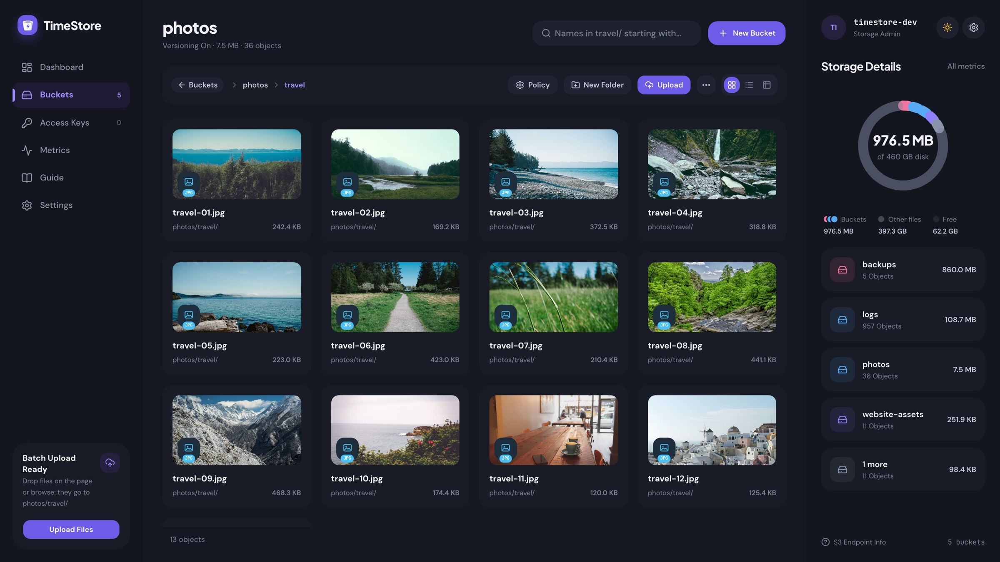
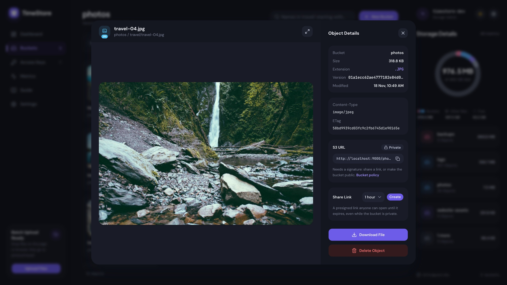
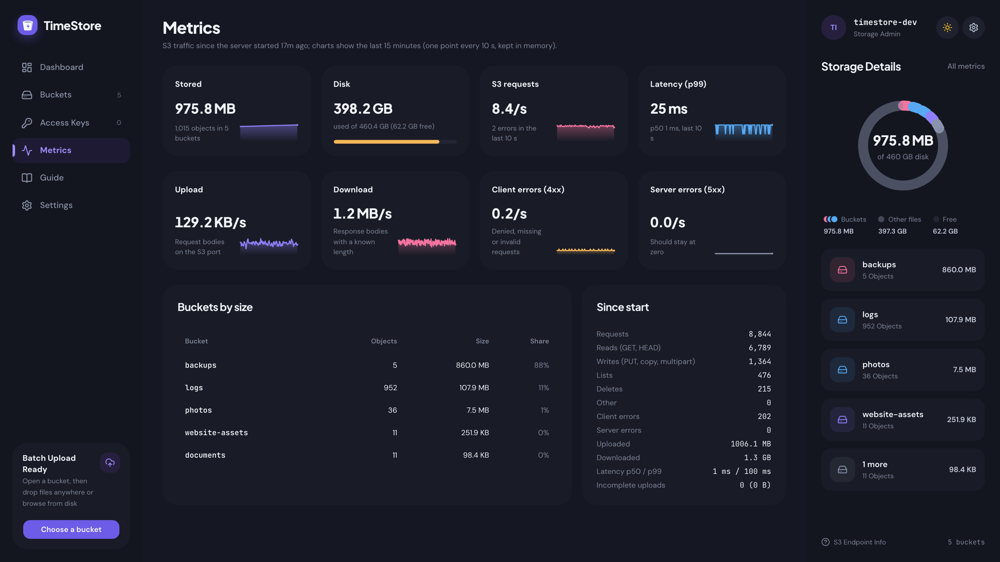

# TimeStore

[](https://github.com/tainguyen1501/TimeStore/actions/workflows/ci.yml)
[](LICENSE)

**A self-hosted, S3-compatible object storage server built for speed, durability and a small footprint.**

TimeStore is a single Native AOT binary (C#, .NET 11) with an embedded admin UI. Point any S3 client at it (AWS SDKs,
the AWS CLI, rclone, s3cmd) and it behaves like Amazon S3: same signatures, same XML, same errors. Every write is on
disk before TimeStore answers, and the server idles at 40–70 MiB of memory.

> **Status: pre-1.0, single node.** The S3 core, multipart uploads, versioning, lifecycle rules, bucket policies and the
> admin UI are done and tested; replication across nodes comes next. See [what works](#what-works) and the
> [roadmap](docs/roadmap.md).



<details>
<summary><b>More screenshots</b>: object browser, preview, metrics</summary>







</details>

## Why TimeStore

**Performance**

- One Native AOT binary: no JIT warm-up, fast start, 40–70 MiB of memory when idle and at most 150 MiB under load in
  our benchmarks.
- Metadata in SQLite with a single writer and **group commit**: concurrent writes share one fsync instead of each
  waiting for its own.
- Immutable blob files on local disk, addressed by id: object keys never become file paths, so key length, depth and
  characters hit no file-system limits.
- Measured, not assumed: the benchmark harness against other S3 servers is part of the repository
  ([results below](#benchmarks)).

**Durability**

- A write is acknowledged only after its data and metadata are **fsynced**: blob first, metadata commit last.
- Overwrites and deletes never change data in place; replaced blobs stay readable for reads in flight, and leftovers
  of interrupted writes are swept automatically.
- Checksums (`Content-MD5`, CRC32, CRC32C, CRC64NVME, SHA-1, SHA-256) are verified on upload and stored.

**Security**

- AWS Signature Version 4 for headers and presigned URLs, with constant-time comparisons and a clock-skew limit.
- Anonymous requests are refused unless a **bucket policy** allows them; access keys can be limited to what bucket
  policies grant.
- Secret keys are stored **encrypted** (AES-GCM, with a master key you keep apart from the data) and shown only once.
- The admin port binds to **loopback by default**. Sign-in uses server-side sessions (only a hash of the token is
  stored), `HttpOnly` + `SameSite=Strict` cookies, same-origin checks and throttling of failed attempts.
- Uploaded content is never rendered as a page on the admin origin (strict CSP, sandboxed downloads, `nosniff`).
- Unsupported features are refused with `NotImplemented`, never silently ignored. Found a vulnerability? See
  [SECURITY.md](SECURITY.md).

**Easy to run**

- One binary or one container, one data directory, no external services.
- A web console for buckets, objects (preview, versions, share links), access keys, bucket policies, lifecycle rules
  and metrics, with a built-in user guide.

## Quick start

With Docker (images for amd64 and arm64):

```bash
docker run -d --name timestore \
  -p 9000:9000 -p 127.0.0.1:9001:9001 \
  -v timestore-data:/data \
  -e TimeStore__S3__RootAccessKey=admin \
  -e TimeStore__S3__RootSecretKey=change-me-please \
  ghcr.io/tainguyen1501/timestore:latest
```

- S3 API: `http://localhost:9000`, region `us-east-1`
- Admin UI: `http://localhost:9001`, sign in with the root key pair above

Try it with the AWS CLI:

```bash
export AWS_ACCESS_KEY_ID=admin AWS_SECRET_ACCESS_KEY=change-me-please AWS_DEFAULT_REGION=us-east-1
aws --endpoint-url http://localhost:9000 s3 mb s3://photos
aws --endpoint-url http://localhost:9000 s3 cp ./cat.jpg s3://photos/
aws --endpoint-url http://localhost:9000 s3 ls s3://photos
```

Without Docker, download the archive for your platform (Linux x64 or arm64, macOS arm64) from
[Releases](https://github.com/tainguyen1501/TimeStore/releases):

```bash
tar -xzf timestore-*-linux-x64.tar.gz && cd timestore-*-linux-x64
TimeStore__S3__RootAccessKey=admin TimeStore__S3__RootSecretKey=change-me-please \
TimeStore__DataPath=./data ./TimeStore.Server
```

The macOS binary is not notarized yet: run `xattr -dr com.apple.quarantine .` in its folder before the first start.

Before you store anything that matters: keep the admin port on loopback or behind a TLS proxy, and back up
`master.key` from the data directory separately from the data, because stored access keys cannot be decrypted
without it ([backup and restore](docs/backup.md)). All settings: [docs/configuration.md](docs/configuration.md).

### Ports

TimeStore listens on two ports, so admin traffic never shares the S3 path:

| Port | Serves | Who uses it | Default address |
|---|---|---|---|
| `9000` (`S3Port`) | The S3 API | Applications, SDKs, the AWS CLI, rclone, share links, public objects | All interfaces |
| `9001` (`AdminPort`) | The admin UI and its API (`/api/v1`) | People signing in with an access key | `127.0.0.1` (`AdminAddress`) |

- The admin port answers only on the machine itself by default. To reach it from elsewhere, put a TLS reverse proxy
  in front of it, set `AdminAddress=0.0.0.0` and `Admin:SecureCookies=true`; sign-in sends a secret key, so never
  expose it over plain HTTP. In the container image the admin port listens inside the container, so the Docker
  command above publishes it on `127.0.0.1` only.
- Behind a proxy or another host name, set `S3:PublicUrl` so the admin UI shows S3 URLs and share links that work
  from outside.
- The request charts in the admin UI count S3 API traffic (port 9000); actions in the admin UI itself are not
  counted.

## What works

| Area | Supported |
|---|---|
| Addressing and auth | Path-style and virtual-host addressing; SigV4 in headers, presigned URLs and `aws-chunked` uploads; anonymous access through bucket policies |
| Buckets | Create, list, head, delete, location, versioning, lifecycle rules, bucket policies |
| Objects | Put, get (ranges, conditional requests), head, delete, multi-delete, copy, user metadata, ListObjects v1 and v2, ListObjectVersions |
| Multipart | Create, upload part, upload part copy, complete (composite and full-object checksums), abort, list parts and uploads, GET/HEAD by `partNumber` |
| Versioning | Enabled and suspended buckets, delete markers; restore older versions in the admin UI |
| Lifecycle | Expiration of current and noncurrent versions, expired delete markers, incomplete multipart uploads |
| Not yet | Multi-node replication, server-side encryption, object lock, object tags, storage-class transitions, IAM users and groups |

Every change is tested end to end with the AWS SDK for .NET, against the regular build and the Native AOT binary.
An opt-in suite also runs the AWS CLI, rclone, s3cmd, 200 tests of [ceph s3-tests](https://github.com/ceph/s3-tests)
and the applicable cases of the official SigV4 test suite. Details:
[docs/research/s3-compatibility.md](docs/research/s3-compatibility.md).

## Benchmarks

We compare TimeStore with other open-source S3 servers using [warp](https://github.com/minio/warp) v1.3.1, the S3
load generator most projects in this space publish their numbers with. The harness is in the repository, so anyone
can repeat the runs: [`deploy/bench/compare.sh`](deploy/bench/compare.sh).

**Method.** Each server runs alone in Docker with the same CPU and memory limits, on a fresh volume, one after the
other on the same machine. Durability is set as close to "fsync before the answer" as each server allows (listed in
the reports). Every workload runs for 20 s, three times; the tables show the median. Throughput is in objects per
second (MiB/s for 16 MiB objects); higher is better. The best result in each row is in bold.

**Linux:** 4-vCPU KVM VPS (Intel Haswell), Ubuntu 24.04, Docker Engine; each server 2 CPUs and 3 GB, warp 1.5 CPUs.
[Full report with latencies](docs/benchmarks/2026-11-17-compare-linux-4vcpu.md).

| Workload | TimeStore | MinIO | SeaweedFS 4.54 | RustFS 1.0.6 | Garage 2.5.0 |
|---|---|---|---|---|---|
| PUT 1 KiB, 1 client | 199 | 208 | 119 | 188 | **254** |
| PUT 1 KiB, 16 clients | **1,161** | 572 | 466 | 1,150 | 338 |
| PUT 64 KiB, 16 clients | **984** | 410 | 299 | 802 | 134 |
| PUT 16 MiB, 8 clients (MiB/s) | **195** | 180 | 86 | 119 | 68 |
| GET 64 KiB, 16 clients | 4,124 | 1,954 | 1,926 | **4,217** | 889 |
| HEAD (STAT), 16 clients | **6,110** | 2,497 | 3,954 | 5,165 | 4,151 |
| Mixed 64 KiB, 16 clients | **2,808** | 1,261 | 1,070 | 1,819 | 454 |
| DELETE (in the mixed run) | **281** | 126 | 107 | 182 | 45 |
| Memory idle / peak, MiB (lower is better) | 39 / **85** | 131 / 567 | 148 / 1,378 | 108 / 494 | **27** / 143 |

<details>
<summary><b>macOS:</b> Apple M4, Docker Desktop; each server 4 CPUs and 4 GB, warp 3 CPUs</summary>

[Full report with latencies](docs/benchmarks/2026-11-17-compare.md). Docker on macOS runs inside a VM: compare the
servers with each other, not these numbers with the Linux ones.

| Workload | TimeStore | MinIO | SeaweedFS 4.54 | RustFS 1.0.6 | Garage 2.5.0 |
|---|---|---|---|---|---|
| PUT 1 KiB, 1 client | 894 | 368 | 237 | 917 | **1,218** |
| PUT 1 KiB, 16 clients | **4,993** | 3,467 | 2,669 | 3,605 | 1,455 |
| PUT 64 KiB, 16 clients | **3,500** | 1,912 | 1,555 | 1,776 | 353 |
| PUT 16 MiB, 8 clients (MiB/s) | **810** | 706 | 471 | 608 | 498 |
| GET 64 KiB, 16 clients | 30,213 | 22,160 | 21,586 | **38,539** | 4,396 |
| HEAD (STAT), 16 clients | 47,116 | 37,000 | 34,136 | **49,843** | 17,122 |
| Mixed 64 KiB, 16 clients | **13,534** | 7,152 | 6,685 | 6,382 | 1,824 |
| DELETE (in the mixed run) | **1,353** | 715 | 668 | 638 | 182 |
| Memory idle / peak, MiB (lower is better) | 71 / **150** | 141 / 520 | 166 / 1,420 | 91 / 846 | **24** / 334 |

</details>

**Read these numbers with care.**

- They are single-node runs of each server with its default settings. Several of these servers are built for
  multi-node or multi-drive clusters, where they behave differently.
- On the 4-vCPU VPS the load generator was often at its own CPU limit, so the fastest servers look closer than they
  are; treat differences under 5% as ties.
- The GET and HEAD data sets fit in memory: they measure the request path more than the disk.
- RustFS has no documented fsync setting, so its durability could not be matched or verified.
- MinIO ran from the community build `pgsty/minio`, because official images are no longer published.

Where TimeStore is behind: single-client small writes (a lone write waits for its own fsync) and, on macOS, GET and
HEAD against RustFS. Both are on the [roadmap](docs/roadmap.md). If you maintain one of these servers and know a
fairer configuration, please open an issue: we will re-run and update the tables. More:
[docs/performance.md](docs/performance.md).

## Build from source

Requirements: the .NET SDK in `backend/global.json`, Node.js 22.13+ with pnpm, and clang for Native AOT.

```bash
# from the repository root
(cd frontend && pnpm install && pnpm build)          # the admin UI, embedded into the server build
cd backend
dotnet run --project Src/TimeStore.Server            # development: S3 on :9000, admin on :9001,
                                                     # key pair timestore-dev / timestore-dev-secret
dotnet publish Src/TimeStore.Server -c Release -r linux-x64   # Native AOT (or linux-arm64, osx-arm64)
```

The container image, from the repository root: `docker build -f deploy/Dockerfile -t timestore .`. Tests, checks and
conventions: [CONTRIBUTING.md](CONTRIBUTING.md).

## Documentation

- [Configuration](docs/configuration.md): every setting, running behind a reverse proxy
- [Backup and restore](docs/backup.md): what to back up, consistent copies, restoring, the master key
- [User guide](docs/user-guide/README.md): the admin UI (also built into the UI)
- [Architecture](docs/architecture.md): layers, storage model, write path, multi-node plan
- [Performance](docs/performance.md): how to benchmark, baselines and comparisons
- [Roadmap](docs/roadmap.md) and [changelog](CHANGELOG.md)
- [Design notes](docs/research/): S3 behaviour and decisions per feature, with sources
- [Contributing](CONTRIBUTING.md) (contributors sign the [CLA](CLA.md)), [security policy](SECURITY.md),
  [conventions for contributors and coding agents](AGENTS.md)

## License

TimeStore is licensed under the [GNU Affero General Public License v3.0](LICENSE) (AGPL-3.0).

- Running unmodified TimeStore is free for any purpose, including commercial use. Applications that talk to it over
  the S3 API are not affected by its license.
- If you modify TimeStore and people use your modified version over a network (for example a hosted service), you
  must offer those users its source code under the AGPL-3.0.
- A commercial license without these terms is available from the maintainers on request.

Copyright (C) 2026 tainguyen1501 and contributors.
